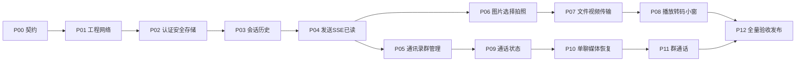

# OpenChat 项目创建与 iOS 实现路线

基准日期：2026-11-17。目标：利用现有业务服务端，从零实现与当前 Android 业务能力一致的 iOS 客户端。

配套：[分模块说明](project-modules.md) · [项目入口](../README.md) · [需求演进记录](../AGENTS.md)。

本文是开发路线和待执行验收要求，不表示 iOS 已创建、平台选型已确定，或当前 Android 已全部联调通过。阶段按依赖关系重新排序，不要求重演 Android 开发中的历史返工。

## 1. 从历史记录提炼出的创建过程

`AGENTS.md` 混合了需求、修改记录、配置补充和验证边界，部分同日修改互相覆盖。按当前可见记录，可以归纳为以下过程；没有记录的项目初始化时间不补造。

| 时间 | 主要建设内容 | 对后续创建项目的启示 |
| --- | --- | --- |
| 2026-11-02 及此前已有基础 | 原生页面、服务器配置、账号登录、会话；11-02 明确接入类型化历史、文本发送、SSE 文本/图片、全局消息身份和实际已读 | 先确定协议、身份和同步语义，再扩展消息种类 |
| 2026-11-03 | PC 表结构/正文对齐、视频下载播放、按需转码、系统画中画、媒体问题诊断 | 业务记录、设备缓存、播放器生命周期分开设计 |
| 2026-11-04 | 真实通讯录、好友申请、统一资料、单聊/群详情、成员管理、图片及文件/视频续传、更多面板和转场 | 用真实关系取代演示数据；每种写操作有明确确认和取消边界 |
| 2026-11-05 | 拍照、相册批次、文件选择渠道、图片浏览与确认防闪、视频通话、工具链整理 | 先完成数据闭环，再做输入、选择和展示细节；依赖不等于功能 |
| 2026-11-06 | 系统通话悬浮、黑名单/删除、重连刷新、底部导航与索引优化 | 多页面和后台变化必须服从同一授权及资源所有权 |
| 2026-11-07 | 单聊语音、视频 P2P 优先、单向 SFU 降级、计时、后台准备、恢复 | 通话是独立业务状态机；媒体连接与业务接听不能混为一体 |
| 2026-11-08 | 群发起/接收、成员布局、视频席位、多端归属、强制呼出、SFU 就绪诊断 | 先区分整通状态、本人状态、设备归属和媒体状态 |
| 2026-11-09 | 群房间活动查询、主动加入、独立成员版本、两人群规则 | 群通话不能按“双人单聊加人数”实现 |
| 2026-11-12 至 11-14 | APK 输出/签名、认证和数据库加密、Debug Database 配置；更新机制见分模块说明 M13 | iOS 从首版建立安全存储，发布机制另按平台设计 |
| 2026-11-17 | 服务器摘要取前 16 位，共享账号文件分区 | 开工前固定存储命名，避免后期路径重做 |

## 2. 必须共同遵守的契约

以下规则应从第一个可运行版本就纳入，而不是临近交付再补：

1. **授权隔离：** 所有请求、数据库 owner、缓存、选择批次、播放和通话绑定服务器、UID、本次授权代次。退出立即撤权，旧响应不得影响新登录。
2. **真实数据：** 公开资料不代表好友；群来源不是单聊房间；客户端不能伪造消息 ID、加入成功、已读、上传完成或通话终态。
3. **消息身份：** 只按全局 `msgId` 识别服务端消息；`clientMsgId` 只确认本地占位和关联重试。
4. **三套进度：** 历史连续区间、SSE 收件、实际阅读水位分别维护，不能用一条推送推进连续历史，也不能把收件当阅读。
5. **精度和时间：** ID 不经 Double；wire 枚举显式赋值；当前无时区 Date 文本按约定时区解析，落库 UTC，展示使用配置时区。
6. **存储契约：** HTTP DTO 与本地扁平正文分离；核对 PC 实际 SQL 后建库，不能因 iOS 便利另造不一致业务表。
7. **安全存储：** 服务端重新核验成功后开加密库；错误密码不能触发删库；Token/数据库密码不明文保存，媒体缓存加密与端到端加密不在现有完成范围。
8. **资源隔离：** 业务认证不发送到 OSS/公开资源；短期签名不落业务库；半文件、未完成分段不能发布成完整缓存。
9. **写请求语义：** 普通副作用请求不盲目自动重试；已约定幂等的消息、RTC 和分片请求保留原身份，按各自规则重试。
10. **取消与补偿：** 客户端取消不代表服务端回滚。迟到成功不重开旧页；按原授权复核并处理，不能用新账号补偿旧操作。
11. **展示与阅读：** 覆盖、转场、旧历史、无焦点或未布局时不新增已读；返回保留草稿/锚点，真正可见后再确认。
12. **证据边界：** 用例存在、代码编译、单设备运行和跨端联调是不同级别的证据，交付时分别记录。

## 3. 开工前先处理的差异

下表是本次静态核对发现的差异或缺口。不能用总结文档替代产品确认、部署确认和设备验收，也不因这些问题阻塞其他独立模块。

| 编号 | 当前事实 | iOS 开工处理 |
| --- | --- | --- |
| D01 SFU 最终断开 | 历史要求曾称最终断开保留业务通话；当前 `RtcVideoController.kt` 的 Disconnected 分支在 `sfuConnected` 时调用 `end()` | 通话阶段前明确以保留还是结束为目标；源码当前行为是结束，不宣称已实现保留；确认后统一各端及测试 |
| D02 群退出 | 早期记录按人数判断；当前 `RtcProtocol` 用 `calleeUid=null` 判群、独立成员版本，并按角色决定结束动作 | 采用当前群协议；普通参与者两人群也 leave，发起人 cancel/hangup；不得概括成所有人只 leave |
| D03 数据库版本 | 历史记录称 Schema 5；源码 `@Database(version = 1)` | 用实际 SQL 和正文契约建立 iOS 当前基线，独立管理 iOS 元数据，不复制旧版本号或 Room identityHash |
| D04 路径前缀 | API 文档要求保留服务器路径；多数业务传 `/capi/...`，`ApiClient` 又限制结果必须在根路径内 | 为 `/` 和 `/api/` 基址建立共同路径用例，先验证再声明支持；保持完整基址参与存储隔离 |
| D05 旧功能边界 | 早期记录称语音/群呼/拍摄/远端置顶未接入、视频仅应用内小窗；当前源码已有后续实现 | 按本路线及分模块状态拆任务，具体入口仍独立核对，例如资料页通话仍未接入 |
| D06 媒体旧参数 | 早期转码为 8 段/16 MiB、前后十秒、浮窗控制区；后续已改 40 段/64 MiB、拖动定位、小窗简化 | 区分普通全屏、应用内小窗、系统画中画和 RTC 悬浮，不混用尺寸及控件 |
| D07 服务端依据缺失 | 当前工作区没有历史引用的 `../openchat-server/resource`，本次未重新核验后端部署或 PC | 开工取得服务端 DTO、枚举、权限与 RTC 资源协议，冻结可联调版本；Android 客户端不是服务端完整契约 |
| D08 iOS 平台契约 | Android 使用 PHONE clientId、ANDROID_ID 摘要、Android 更新终端；不能推断 iOS 取值 | 确认 clientId/terminal、设备标识生成和稳定性、设备归属比较、同账号登录替换策略；不得冒充某台 Android |
| D09 验证欠账 | 11-17 路径调整仅记录静态检查；历史测试不能覆盖当前版本，历史用例也需核对当前是否仍存在 | 将跨端样本、现版 Android 行为及真实部署验证纳入交付，不把旧夹具复制成 iOS 真值 |

定位：[控制器](../app/src/main/java/com/im/openchat/chat/rtc/RtcVideoController.kt)、[RTC 协议](../app/src/main/java/com/im/openchat/chat/rtc/RtcProtocol.kt)、[数据库定义](../app/src/main/java/com/im/openchat/common/data/ConversationRoomDatabase.kt)、[网络层](../app/src/main/java/com/im/openchat/common/network/ApiClient.kt)。

## 4. iOS 的职责划分

建议沿用以下逻辑分层，不要求照搬 Kotlin 文件数量，也不要求拆成多个工程。Swift、界面框架及依赖版本由 iOS 工程实际选型确定。

| 逻辑模块 | 应承担的职责 | Android 对照 |
| --- | --- | --- |
| AppSession / AppNavigation | 当前授权、窗口/前后台、路由、覆盖和阅读资格 | `OpenChatApp`、`PageSlideHost`、`WindowForeground` |
| Network / Protocol | HTTP、SSE、取消、类型化 DTO、错误分类 | `ApiClient`、各 `Protocol` |
| SecureSessionStore | 会话及账号提示保护、撤权、服务端重新校验 | `ChatStore`、`LocalCredentialCipher` |
| ContentStore / LocalFiles | PC SQL、事务、账号分区、完整缓存和临时文件 | `ConversationDatabase`、`PcContentSchema`、`LocalStorageIdentity` |
| Conversations / Messages | 快照、历史、发送确认、收件、摘要及实际已读 | `chat/data` |
| Directory / GroupManagement | 真实关系、资料、申请、黑名单、群权限 | `address`、`GroupDetailsRepository` |
| MediaTransfer / MediaPlayback | 选择、来源副本、上传下载、播放与转码 | `MediaUpload*`、`ResumableDownloads`、`VideoPlayback*` |
| Calls / CallMedia | 权威状态、设备归属、P2P/SFU、媒体清理及 UI 状态 | `chat/rtc` |
| Settings / Distribution | 主题字号、本地偏好、退出、平台发布 | `me` |

系统能力只给出**待评估方向**，不在本文承诺 Apple API 可用版本、权限资格、审核结果或具体 SDK 兼容性。本次未获得可引用的 Apple 在线文档内容；实施时需核对当前官方文档并做目标设备验证。

| Android 实现 | iOS 评估方向 | 必须保持的业务含义 |
| --- | --- | --- |
| Keystore + DataStore 认证密文 | Keychain/系统保护存储；普通偏好与机密分开 | 按服务器隔离、重新校验、退出撤权，不同步设备机密 |
| Room + SQLCipher | 可执行已核对 SQL 的加密 SQLite 方案；逐项核验参数与文件格式 | 表/正文/事务一致不等于跨端数据库二进制互换 |
| Kotlin Serialization | Swift 类型化编解码，例如 Codable | 保留 Int64/字符串、null、显式枚举和严格业务校验 |
| OkHttp / SSE / Flow | 原生网络流与可取消异步任务，独立 SSE 生命周期 | 唯一授权连接、补查与去重、不能拿普通一次性请求承载长流 |
| MediaStore / OpenDocument / 相机结果 | 系统照片权限、文件选择、相机及私有副本适配 | 有限照片、取消、后台、迟到结果；不能默认将 HEIC 改码成已支持格式 |
| Media3 / TextureView | AVFoundation/播放器及相应画中画能力评估 | 完整本地文件、原播放实例、位置保存、媒体覆盖已读保护 |
| FFmpeg 按需 HLS | 评估可分发转码组件、编解码范围及请求驱动分段能力 | 保留原文件、目标位置转码、取消后等待释放；不强制照抄 Android 二进制 |
| WebRTC + LiveKit Android | 对应 iOS 媒体 SDK，先做 P2P/SFU 互通样机 | 相同信令、房间、身份、版本、设备归属和单向降级 |
| 前台服务 + 跨应用悬浮窗 | 应用内小窗、平台画中画/音频会话及后台能力独立验证 | 缩小/还原不重建业务通话；不能承诺任意跨应用悬浮或持续后台相机 |
| 前台 SSE 来电 | 首版同样以前台发现为基线；系统来电/PushKit/CallKit 另立扩展任务 | 不把后台唤醒当作现有后端已经提供；需新增推送及系统集成契约时另行确认 |
| APK 下载与安装 | 先确定 iOS 分发渠道，再设计版本提示与更新入口 | 不沿用 Android APK 接口、包校验或安装器行为冒充 iOS 更新 |

## 5. 阶段路线



图中为主要依赖；P05 与 P06 可并行，P09 信令开发可与媒体传输并行。各阶段都应保留真实空态、失败态和取消路径，不用假成功完成展示。下文测试名称来自已有开发记录，用于定位历史场景；实施时先确认当前检出是否包含对应文件，不能视为现版已通过的证据。

### P00 协议和范围冻结

**前置：** 当前 Android 源码、PC 实际建表/正文代码、可用后端协议与测试环境。

**交付：** 端点/DTO/枚举清单、PC SQL 基线、iOS 平台身份方案、功能状态矩阵、D01–D09 决策记录。明确首版对齐当前能力，未接入功能不默认扩展。

**验收：** 用共用样本覆盖超出 2^53 的正 Long、null 群被叫、成员版本、未知类型、时区、空成功/业务失败；确认真实后端支持群房间查询和成员版本。先冻结协议再设计表和模型。

**阅读：** 分模块说明第 5 节、`MessageHistoryModels.kt`、`MessageBodies.kt`、`RtcProtocol.kt`、[PC 对齐](project-modules.md#m02)。

### P01 工程骨架、网络与导航

**前置：** P00 的平台身份和 API 根地址约定。

**交付：** 原生三标签与子页路由、统一主题/字号、安全区、网络取消与错误分类、独立业务/资源客户端、授权作用域接口。依赖集中管理，不先塞入所有未接入功能。

**验收：** `/` 与 `/api/` 基址请求不丢前缀；重定向不能带走认证；取消确实取消任务；小屏/大字号无重叠；进入/返回和标签方向一致；重复返回不越级；切授权清旧页面。空数据时可使用但不展示演示联系人。

**阅读：** [API](project-modules.md#m01)、[转场](project-modules.md#m03)、`common/config/AppConfig.kt`。

### P02 认证、加密与账号分区

**前置：** P01；PC 表定义及所选加密驱动确认。

**交付：** 密码登录、globalUid 恢复校验、加密会话/账号提示、内容库和 PC 结构初始化、16 位服务器目录、文件分区、owner 撤权、退出/切换账号、备份策略。

**验收：** 同 UID 不同服务器/端口/路径隔离；规范化等价地址一致；错误密码不删库；密文损坏不明文回退；未验证前不开库；同账号重登旧 owner 无效。退出远端失败仍本机退出，本地清认证失败应阻止新登录并可重试。关闭后的旧任务不能再次开库。

**阅读：** [加密](project-modules.md#m02)、`LocalStorageIdentity.kt`、`LocalCredentialCipher.kt`、`ConversationDatabase.kt`、`PcContentSchema.kt`。

**限制：** 不导入 Android/PC 数据库文件；不为上线自动增加旧格式迁移。本地安全目标从此阶段实现，不能等全部聊天功能完成后再补。

### P03 会话、缓存与连续历史

**前置：** P02 的授权库和事务能力。

**交付：** 会话列表、详情、真实房间、头像按需加载、立即打开缓存、50 条历史分页、缺口补查、类型化正文、扁平存储、摘要与排序、滚动锚点。

**验收：** 超过一页、整页后空末页、同页/跨页重复、时间顺序与 ID 顺序不同、最新缺口中断后恢复；不同 msgId 同 clientMsgId 保留两条；回复不因 upsert 丢失，终态不被回放恢复。旧快照不覆盖新摘要，阅读旧历史时新消息不拉到底部，离群只读缓存。

**阅读：** `MessageHistoryRepository.kt`、`MessageHistoryProtocol.kt`、`PcMessageContent.kt`、`ConversationPreview.kt`；测试参考 `PcMessageContentTest`、`ConversationInfoTest`、`ChatFollowLatestTest`。

### P04 文本收发、SSE 与实际已读

**前置：** P03 的全局消息身份、事务和历史水位。

**交付：** 文本发送队列及手动重试、授权唯一 SSE、文本/图片收件箱、未知房间暂存、连接恢复刷新、持久阅读待办、角标及焦点/覆盖检测。

**验收：** HTTP 受理不先假显示成功；丢响应后原 clientMsgId 重试；重复 SSE/历史仅一条；旧授权响应不能失效新账号。首次 SSE 连接失败后恢复也刷新目录。后台、旧历史、预览和转场不新增已读；本地阅读立即消角标，旧响应不恢复，断网重启后补交；SSE 不推进历史连续边界。

**阅读：** [SSE](project-modules.md#m05)、`MessageSendRepository.kt`、`MessageReceiveRepository.kt`、`ConversationReadRepository.kt`；测试参考 `MessageReceiptDatabaseTest`、`ConversationReadDatabaseTest`、`ChatReadObserverTest`。

**里程碑 A：** 可登录、跨端文本互发、重启补历史和可靠已读。它是基础可用版本，不代表全部功能已对齐。

### P05 通讯录、资料、申请及群管理

**前置：** P04 的授权刷新与真实房间导航。

**交付：** 好友/群目录、搜索与字母索引、统一资料、申请分页/回复/接受/单条阅读、黑名单/删除、单聊/群详情、置顶/免打扰、群成员增减、群名/公告、已有二维码和退出群。

**验收：** 超过 100 好友、超过 10 申请、游标循环防护；头像不确认申请已读；关系失败不能当陌生人；群来源发消息必须重新查单聊；拉黑后可解除但不恢复已删关系；旧目录不能恢复删除项。覆盖所有群角色组合、提交前降权和目标离群；退出保留历史；写失败不乐观伪造状态。

**阅读：** [通讯录](project-modules.md#m06)、[单聊信息与群管理](project-modules.md#m07)；测试参考 `AddressProtocolTest`、`FriendSettingsRepositoryTest`、`GroupMemberRemovalTest`。

### P06 图片、相册、拍照与预览

**前置：** P04 的发送确认及授权缓存。

**交付：** 有限照片授权、四列多选相册、九项有序混合批次、系统拍照结果、原字节图片签名上传、统一状态区、原图缓存和消息大图分页浏览。混选视频的完整发送依赖 P07；之前不能假提交视频。

**验收：** 四类支持图片原字节一致；超 50 MiB/4000 万像素、坏文件头、HEIC 等不支持类型明确失败；“原图”开关不改变字节；拍照取消和迟到结果不发消息；已入队项不因取消批次被删；第二项重试不重发第一项；换 ID 确认不改变图片约束；预览不补历史、不新增已读，失效项正确移除。

**阅读：** [图片发送](project-modules.md#m08)、`ImageUploadProtocol.kt`、`PendingImageUpload.kt`、`ImagePreviewRequest.kt`；测试参考 `SignedImageUploadTest`、`ChatImageConfirmationTest`、`ChatPhotoCaptureLifecycleTest`。

### P07 文件选择、分片上传与断点下载

**前置：** P06、P02 的安装级来源隔离及 P03 的 temporary 正文。

**交付：** 四渠道文件选择、相册三列、混合有序发送、后缀分流及内容校验、16 MiB 分片、真实视频封面/时长、temporary 最终确认、持久取消、强 ETag/Range 续传和完整缓存发布。

**验收：** 文件大于 Int 范围仍正确计数；200/206/416、弱 ETag、资源变化、签名过期分别处理；半文件不播放。暂停/继续不换原来源，取消失败重启不能继续上传；另一安装无法继承来源；complete 丢响应后不重复创建消息；不支持视频不能悄悄当文件；低磁盘空间和复制中断不污染正式缓存。

**阅读：** [文件选择](project-modules.md#m08)、[传输与占位](project-modules.md#m09)；测试参考 `DownloadRangeTest`、`ResumableDownloadsTest`、`MediaUploadDatabaseTest`、`AutomaticFileSelectionTest`。

### P08 本地视频、转码与系统小窗

**前置：** P07 完整视频/封面缓存；确认 iOS 目标格式、转码组件及分发方案。

**交付：** 本地播放器、真实画面与声音、秒级续播、进度拖动、横屏/缩放、按需转码或经确认的等效实现、应用内小窗与系统画中画适配、后台和 native 释放。

**验收：** 直接播放与不支持原格式的兼容路径都能显示持续变化的真实画面；跳转未准备位置不等待前面全转完；暂停/关闭停止工作；重试不被旧回调覆盖；小窗/全屏不重建播放或重置位置；授权失效不暴露聊天；系统回收、权限与机型限制有明确结果。

**阅读：** [播放、转码与画中画](project-modules.md#m10)；测试参考 `VideoPlaybackDeviceTest`、`VideoPlaybackWindowDeviceTest`。

**里程碑 B：** 文本、图片、文件、视频、通讯录与群管理形成闭环。播放不支持格式若仍缺兼容方案，必须作为明确差异，不计完整对齐。

### P09 通话业务状态与前台来电

**前置：** P04 的唯一 SSE、P05 的真实房间/成员；完成 D01、D07、D08 确认。

**交付：** 账号级唯一通话控制器、活动记录确认、固定请求 ID 创建/重试、权威快照版本校验、前台邀请队列、接听/拒绝/结束、设备归属、生命周期和日志。先用模拟媒体边界验证业务竞争，再接 P10 真实采集。

**验收：** 取消/拒绝权限不结束旧通话，创建成功才交接；新邀请先到、旧终态后到也能接听；一通定格期间重复邀请不重复弹窗；接听响应丢失后复核，另一设备接听只本机清理；未知归属不采集。媒体状态和业务终态分离，不伪造聊天通话消息。

**阅读：** [单聊通话与设备归属](project-modules.md#m11)、`RtcRepository.kt`、`RtcProtocol.kt`；测试参考 `RtcProtocolTest`、`RtcRedialTest`、`RtcIncomingCallTest`。

### P10 单聊音视频媒体、小窗与恢复

**前置：** P09、iOS 媒体 SDK 样机；平台后台和画中画方案已明确。

**交付：** 语音/视频权限与采集、P2P OFFER/ANSWER、非 trickle、服务端确认后单向 SFU、质量调整、摄像头通知、麦克风/远端播放开关、前后置与选流、计时、缩小/还原、异步释放、单聊重启确认恢复。

**验收：** iOS 与 Android/PC 双向发起且双向有声/持续视频；关闭相机保留通道，重开继续；18 秒首连/6 秒断开降级，服务端 SFU 确认前不擅取 Token；SDK 发布返回不提前报告连接完成。计时接听归零且不因切媒体重置；新通话等待旧采集释放。恢复沿原 callId 和接听时间，不自动接听/采集；46001/46004/46005/46006 分别处理，不误当登录失效。

**阅读：** [单聊音视频、恢复与通话记录](project-modules.md#m11)；测试参考 `RtcDirectMediaTest`、`RtcMediaQualityTest`、`RtcCallTimingTest`、`RtcBackgroundOverlayTest`。

**边界：** 应用内小窗等价不等于已完成跨应用/后台适配。电话打断、音频路由、锁屏、后台相机及系统回收须真机验证；D01 最终断开的预期以确认记录为准。

### P11 群通话、成员版本与视频席位

**前置：** P10 SFU 与资源释放、P05 群关系；后端已部署群房间活动查询和成员版本协议。

**交付：** 先查群房间、无通话再选人、显式邀请名单、主动加入/再加入、默认语音、本人状态/版本、九宫格与分栏、入房等待、发声标记、视频席位领取/续租/释放。

**验收：** 两人群与多人群均按群模型；被邀请者未接听时其他人先接听不关本人的邀请；未受邀、拒绝、过期、离开后均按权限加入；其他设备仍 ACCEPTED 不接管。创建竞争复用原 callId/名单；缺失成员首次 version=1，后续本人 version；低版本及同版本冲突不覆盖。九格是展示上限，视频席位是独立规则；拒绝相机或续租失败仍保留音频。

**阅读：** [群通话](project-modules.md#m12)、`RtcGroupMembers.kt`、`RtcGroupMemberLayout.kt`、`RtcSfuConnection.kt`；测试参考 `RtcGroupJoinTest`、`RtcGroupOutgoingTest`、`RtcGroupSpeakingTest`、`RtcSfuConnectionTest`。

**里程碑 C：** 全部目标业务开发完成，转入全量互通及平台验收。群通话强杀恢复、后台来电唤醒仍不属于已对齐范围。

### P12 统一交互、跨端验收与发布

**前置：** P05、P08、P11；iOS 分发渠道和版本策略确定。

**交付：** 全入口一致性、未接入提示、主题/字号与安全区、真实失败和重试体验、版本入口、隐私权限说明、发布产物与验收记录。Android APK 安装和签名不是 iOS 的实现模板。

**验收：** 执行下一节矩阵，逐项记录版本、设备、服务部署、结果和未解决差异。确认日志与备份不含机密，退出释放网络/媒体/库，更新前后账号数据按既定规则处理。所有平台特有能力明确是否支持及退化方式。

**阅读：** [发布语义参考](project-modules.md#m13)、[项目分块状态](project-modules.md)、[数据库对齐与索引](project-modules.md#m02)。这里列出的验证应由后续实施安排，本次未执行。

## 6. 跨端验收矩阵

不能只用同平台两台模拟器。至少准备两名不同账号用户、多设备同账号、一个普通群和足够成员的群；覆盖 iOS→Android、Android→iOS、iOS→PC、PC→iOS，另检查同账号多端竞争。

| 范围 | 最低场景 | 合格结果 |
| --- | --- | --- |
| 认证与隔离 | 同 UID 切服务器、同服务器换号、退出重登、授权到期、核验断网 | 不串数据，旧任务无访问权，网络故障不误清库 |
| 消息身份 | 重复推送、历史回放、同 clientMsgId 不同 msgId、响应乱序 | 真消息保留、不重复，终态不倒退 |
| 历史 | 多页、空末页、最新缺口、取消后重进、未知类型 | 连续边界正确，无漏页或无限游标 |
| 实际已读 | 底部、旧历史、键盘、详情/预览/通话覆盖、转场、断网重启 | 只确认真正可见正文，旧快照不恢复角标 |
| 关系和权限 | 新申请、回复/接受、删除/拉黑/解除、群降权/移出/退出 | 真实关系决定动作，失败不假成功 |
| 图片 | 多格式、超限/坏文件、九项混选、拍照取消、确认换 ID | 字节不被隐式改码，无重复发送或明显布局跳动 |
| 文件/视频 | 分片中断、续传、取消失败重启、签名过期、资源变化 | 半文件不发布，取消不复活，最终消息来自服务端 |
| 播放 | 直播放、兼容转码、跳转、暂停、横屏、小窗、关闭 | 真实画面/声音，位置连续，清理不阻塞 UI |
| 单聊 | 双向拨打、强制呼出是/否、权限拒绝、另一设备接听 | 原通话保护与交接正确，非归属设备不采集/不误挂断 |
| 媒体协商 | P2P、任一端 FALLBACK、SFU 失败重试、关开相机、Wi-Fi/蜂窝切换 | 服务端状态一致，SFU 不回切，旧回调不串入新通话 |
| 恢复 | 杀进程后前台发现、同/异设备恢复、460xx、拒绝权限 | 用户确认后才接管，保留身份与时间，错误码不误登出 |
| 群通话 | 两人/多人、晚加入、退出重入、并发创建、超过九人、席位满/续租失败 | 成员版本独立，普通成员离开不结束整场，音视频权限正确 |
| 平台生命周期 | Home、锁屏、音频打断、后台、小窗返回、权限撤销、系统回收 | 行为符合已确认平台方案，不宣称未支持的后台能力 |
| UI 与可访问性 | 小屏、横屏、深浅主题、系统大字号、连续点击返回 | 无遮挡/穿透，状态切换不跳布局，草稿和滚动保持 |
| 发布与诊断 | 更新入口、签名/渠道验证、密文/日志检查、资源释放 | 不暴露凭据，发布包可验证，结果有设备和版本证据 |

建议每项结果使用“未执行 / 通过 / 失败 / 经确认的差异”，附复现步骤与证据。Android 已有用例可作为场景参考，不能机械翻译平台 API 或直接沿用旧通过状态。

## 7. 不应在移植时顺带扩展的功能

为了可衡量地完成对齐，以下保持未接入或另立任务：

- 注册、短信、找回密码及正式协议内容；服务端个人资料编辑、完整账号安全设置。
- 语音消息录制/播放、表情输入/发送/收藏、OCR 业务、位置/红包/礼物/转账。
- 群创建/解散、扫码入群/二维码刷新、好友备注编辑、群昵称编辑、完整聊天查找/清空/删除同步。
- 文件打开/分享/另存为、收藏文件、图片编辑/压缩、相册预览、录像入口、后台附件传输。
- 系统推送/锁屏来电、群强杀恢复、端到端加密、全量多端数据库互导及冲突解决。
- 把调试数据库依赖当成已具备加密库实时查看、只读管理或安全监听能力。

未接入 UI 继续明确提示或禁用；若决定实现，要补服务端契约和验收，不以“iOS 对齐”名义默认扩大范围。

## 8. 每阶段交付记录模板

以下模板用于后续任务/PR，不代表本次执行结果：

```text
阶段：Pxx / 名称
依据：功能编号 Mxx、Android/PC/服务端版本
已确认契约：字段、枚举、权限、幂等与取消规则
本次交付：实际入口和可观察行为
平台差异：采用方案、限制、确认记录
数据影响：表/正文/路径/机密/备份；无变更也注明
验证：构建、协议、数据库、UI、真机、跨端分别记录
结果：通过 / 失败 / 未执行 / 经确认的差异
剩余问题：复现条件、责任范围、下一阶段依赖
文档：更新分模块说明、路线和验收结果
```

建议开工顺序为 P00–P04 先形成基础聊天闭环，然后并行完成目录与媒体，最后接入通话和平台发布。所有阶段完成且验收矩阵有对应证据后，才能声明 iOS 已实现约定范围的相同功能。
