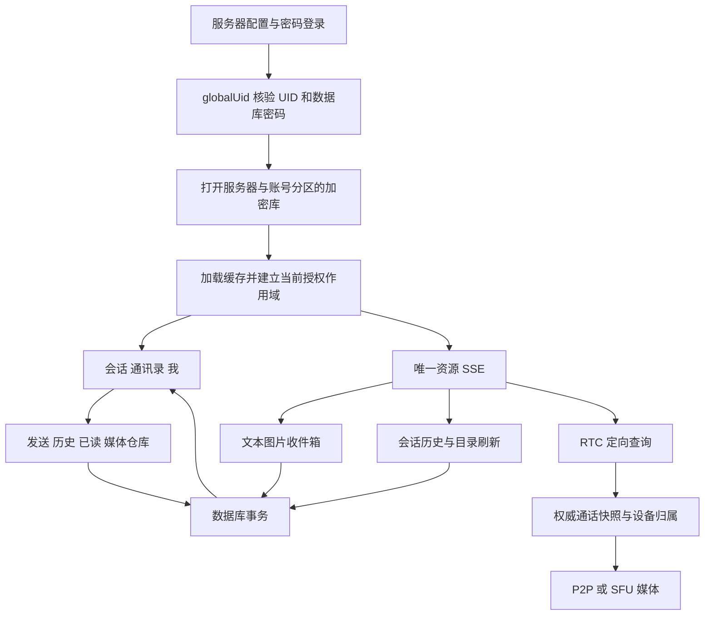

# OpenChat 项目分模块说明

基准日期：2026-11-17。面向新接手项目的开发者，以及后续实现相同业务能力的 iOS 团队。

配套：[项目入口](../README.md) · [项目创建与 iOS 实现路线](ios-implementation-roadmap.md) · [需求演进记录](../AGENTS.md)。

## 1. 范围与依据

OpenChat 当前是原生 Android 即时通信客户端，包含登录、会话、通讯录、个人设置、消息与媒体传输、视频播放、单聊音视频和群通话。共用既有业务服务端与媒体服务，业务语义参考 PC 客户端。

本说明依据当前源码、AGENTS 记录及已合并的专题内容汇总，是各模块的统一说明，不声称已重新验证 PC、服务端或线上部署。本工作区未找到历史文档引用的 `../openchat-server/resource` 目录；开发 iOS 前需重新取得对应服务端协议。历史记录中的测试结果只适用于记录所述版本与场景。

本文“已接入”表示源码已有业务调用和状态处理；“仅 UI/依赖”表示不能作为可用业务；“待验证”表示需要构建或设备联调。源码与文档有冲突时明确列出，不自行选择并改写业务。

## 2. 工程和职责边界

`settings.gradle.kts` 实际只包含 `:app`。IDE 中的 `OpenChat.app.main`、`unitTest`、`androidTest` 是源码/测试视图，不是五个独立业务模块。

源码根目录：`app/src/main/java/com/im/openchat/`。

| 目录/入口 | 职责 | 关键文件 |
| --- | --- | --- |
| `MainActivity.kt` | Android 生命周期、窗口、普通视频画中画宿主 | `MainActivity.kt` |
| `common/ui` | 应用授权作用域、导航、共享组件和主题 | `OpenChatApp.kt`、`PageSlideHost.kt`、`BottomTabs.kt`、`Avatar.kt` |
| `common/config` | 默认服务器、显示时区、字号范围 | `AppConfig.kt` |
| `common/network` | API、无凭据资源下载、签名上传、缓存 | `ApiClient.kt`、`ResumableDownloads.kt`、`SignedUploads.kt` |
| `common/network/sse` | 唯一资源流、重连、授权失效和日志 | `ResourceSseClient.kt`、`SseStream.kt`、`SseModels.kt` |
| `common/data` | 认证密文、加密库、PC SQL、账号隔离、资料缓存 | `ChatStore.kt`、`ConversationDatabase.kt`、`PcContentSchema.kt`、`LocalStorageIdentity.kt` |
| `login` | 密码登录、服务器配置、恢复校验 | `AuthRepository.kt`、`AuthModels.kt`、`LoginScreen.kt` |
| `chat/data` | 会话、历史、发送、接收、已读、附件和群管理 | 各 `Repository`、`Protocol`、`MessageBodies.kt` |
| `chat/ui` | 聊天、详情、选择器、媒体展示与播放 | `ChatScreen.kt`、`ChatsScreen.kt`、`VideoPlaybackHost.kt` |
| `chat/rtc` | 业务通话状态、P2P/SFU、设备归属、悬浮和媒体释放 | `RtcVideoController.kt`、`RtcRepository.kt`、`RtcProtocol.kt`、`RtcDirectMedia.kt` |
| `address` | 好友/群目录、资料、申请、黑名单及删除 | `AddressRepository.kt`、`AddressProtocol.kt`、`UserProfileRoute.kt` |
| `me` | 本人资料、主题/字号/通知偏好、退出和应用更新 | `ProfileScreen.kt`、`SettingsPage.kt`、`update/` |

资源按 `res/common`、`res/chat`、`res/address`、`res/login`、`res/me` 分组，共用 `R`；图标以这些目录内的实际资源为准。测试源集约定为 `app/src/test` 和 `app/src/androidTest`，历史用例名称不代表当前检出一定包含对应文件。

当前技术配置来自 [Version Catalog](../gradle/libs.versions.toml) 和 [app 配置](../app/build.gradle.kts)，不代表推荐 iOS 使用相同库或版本：

| 范围 | Android 当前配置 |
| --- | --- |
| UI | Kotlin 2.2.10、Compose BOM 2026.02.01、Material3 |
| 网络与协议 | OkHttp 5.3.2、OkHttp SSE、Kotlin Serialization 1.9.0 |
| 存储 | Room 2.8.5、SQLCipher 4.20.0、DataStore 1.3.0、Android Keystore |
| 通话 | LiveKit 2.29.2、现有 WebRTC 能力 |
| 视频播放 | Media3 1.11.1、FFmpeg Kit 8.1.9 |
| 工程 | AGP 9.5.0；minSdk 24，compileSdk/targetSdk 37 |
| 尚非完整功能的依赖 | 中文 OCR 16.0.1 仅配置；Debug Database 1.0.7 仅 Debug 引入 |

## 3. 总体数据流



这是逻辑职责图，不表示所有任务必须串行。需要串行的是共享快照写入、同一历史分页、通话状态操作与原生资源释放等具体边界；网络等待不应长期阻塞本地阅读事务。

授权作用域是所有模块的共同前提：服务器、UID 和本次授权代次共同决定结果能否发布。同 UID 退出后重新登录也属于新授权，旧回调不能重新开库、更新界面、发送附件或结束新通话。

## 4. 分块功能说明

<a id="m01"></a>

### M01 网络、登录与会话生命周期

已接入账号密码登录、服务器设置、已保存会话重新核验、本人资料读取、切换账号和退出登录。

1. 使用配置服务器请求登录，读取 UID、Token、`clientSqlPassword`。
2. 请求 `globalUid` 核验；使用本次核验返回的密码打开对应内容库，加载成功再进入主页。
3. 加密保存会话，创建授权内仓库与唯一 SSE；恢复会话不能跳过在线核验。
4. 失效或退出先撤销本机访问。主动退出删除保存的认证，再以旧令牌快照尽力通知服务端；远端失败不恢复本机登录。

业务 API 统一添加 `clientId`、`X-Device-Id` 和必要的 Bearer；资源下载/OSS 直传使用独立无业务凭据通道。服务器要求 HTTPS，回环开发地址可 HTTP；拒绝凭据、片段和越出配置根地址的请求。

源码大量调用使用 `/capi/...`，而网络层要求结果保留基址路径前缀。**含非根路径的服务器地址仍需专项验证**，不能仅依据文档中的“支持路径前缀”宣称所有业务已支持。iOS 应明确设计路径拼接并覆盖该用例。

短信、注册、密码找回和正式协议内容未接入；没有离线绕过核验进入业务页或多账号令牌管理界面。

LiveKit 地址在 `globalUid` 核验后通过 `GET /capi/rtc/config` 获取 `data.serverUrl`，要求 WSS，回环可 WS，不接受凭据、查询或片段。请求最多三秒；媒体配置缺失不阻断普通聊天，但真正的 401/403 与取消继续按认证规则处理。每次进入重新刷新，通话可使用本次 Token 响应中的有效地址作为空配置的后备。

源码：`login/data/AuthRepository.kt`、`common/network/ApiClient.kt`、`common/ui/OpenChatApp.kt`。

<a id="m02"></a>

### M02 本地存储、安全和缓存

认证 JSON 与账号提示通过安装级 Keystore AES-256-GCM 加密后保存到 DataStore；附加认证数据绑定完整规范化服务器和用途。登录密码不持久化。普通主题、字号等偏好不是认证信息。

内容库使用 Room + SQLCipher。当前 [数据库注解](../app/src/main/java/com/im/openchat/common/data/ConversationRoomDatabase.kt) 为 **`version = 1`**；旧文档中的 Schema 3/4/5 是历史记录，不能用作 iOS 建库版本。

```text
服务器标识 = 规范化完整 API 地址去掉末尾斜杠
服务器目录 = SHA-256(服务器标识 UTF-8) 的小写十六进制前 16 位
账号分区 = <服务器目录>/<正 Long UID>
数据库 = databases/<服务器目录>/<UID>.sqlite
```

规范化保留协议、非默认端口和路径；域名与 IP 不视为同一服务器。附件、视频、上传源、消息图片/表情/群二维码和媒体临时目录使用同一账号分区。**仅目录摘要截为 16 位，文件内容/资源校验仍用完整摘要**；公开头像沿用公共资源缓存分区。

PC 基线包含 23 张业务表，Room 管理其中 13 张，其余由 SQL 回调安装。业务分组如下，完整 SQL 以 `PcContentSchema.kt` 为准：

| 表组 | 主要表 |
| --- | --- |
| 资料与名称 | `profile`、`contacts`、`contact_name_cache` |
| 会话与阅读 | `conversations`、`conversation_preferences`、`conversation_remote_summary`、`conversation_read_state` |
| 消息与连续历史 | `messages`、`message_sync_state`、`message_replies`、`message_recall_text`、`message_auto_retry` |
| 删除与清理 | `conversation_deletions`、`conversation_file_cleanup` |
| 媒体与上传来源 | `files`、`attachment_files`、`video_files`、`video_playback`、`file_upload_sources`、`video_upload_sources` |
| 表情结构 | `emojis`、`emoji_hashes`、`emoji_order` |

存在表不代表对应业务已接入。PC 的 7 个命名基线索引之外，Android 在打开/创建回调补充已读外键索引。修改表前须核对 PC 实际定义；另建端侧表仍需按仓库约定取得批准。

旧明文库、旧 64 位摘要命名库及旧文件分区不迁移、不自动删除，也不双读。已有 Room 版本不匹配重建规则与错误密码是两件事：错误密码、网络失败或普通磁盘异常不能作为删库理由。

退出/失效撤销 owner，关闭连接并清理驱动密码缓冲；数据库和认证 DataStore 排除备份及迁移。媒体文件未整体加密，未实现消息端到端加密，也未证明 PC/Android 数据库文件可以互换。

Android 补充索引由 `PcContentSchema.ensureAndroidIndexes` 在建库/打开时幂等安装；不能只抑制 Room 外键索引警告而遗漏实际 SQL：

```sql
CREATE INDEX IF NOT EXISTS idx_conversation_read_conversation
ON conversation_read_state(conversation_id);
```

PC 表结构核对入口为关联工程 `electron/services/database/database-user.ts`，连接配置为 `database-connection.ts`，媒体正文位于 `shared/media/`。Room 主键空值约束、元数据、加密参数和端侧辅助状态须逐项核对，不能将同名表视为完全一致。

源码：`common/data/ConversationRoomDatabase.kt`、`PcContentSchema.kt`、`PcMessageContent.kt`、`LocalCredentialCipher.kt`、`LocalStorageIdentity.kt`。

<a id="m03"></a>

### M03 应用导航、主题与个人设置

主入口为“会话、通讯录、我”。进入子页从右侧滑入，返回当前页向右滑出、下层固定；底部切页按标签位置决定方向，标准动画 260ms。授权变化直接销毁旧导航及截图。

底部三项等宽，常规字号内容区最小 48dp，系统安全区额外计算，大字号允许统一增高。主题与字体设置持久化；字号范围 85%–130%，叠加系统字号。

详情、资料、媒体预览和通话覆盖时保留聊天草稿/列表，但阻止底层触摸和新增已读。转场期间也禁止新增阅读进度。业务取消不能为了离场动画延后。

“我”进入时从服务端获取真实昵称、头像、签名；现有个人资料编辑保存本地展示，不等于服务端资料编辑接口已接入。通知偏好不等于系统推送已实现。收藏、表情管理及部分设置项仍为提示。

源码：`common/ui/OpenChatApp.kt`、`PageSlideHost.kt`、`BottomTabs.kt`、`me/ui/`。

<a id="m04"></a>

### M04 会话、历史与消息模型

会话列表读取全部可见快照，按置顶、活跃时间及房间号排序；区分群聊、单聊、文件助手。首次进入聊天立即显示缓存和输入框，详情与历史异步加载，不用整页等待。

历史每页 50 条，从最新页补到已确认边界，再按服务端游标向前分页。响应按时间组织，不假定按消息 ID 排序；使用最大/最小 ID 校验边界。消息与连续区间在同一事务保存，缺口未补齐不能提前推进同步边界。

**服务端消息唯一身份是全局 `msgId`，模型/数据库为 `id`。** `clientMsgId` 只关联本地发送和重试；不同服务端 ID 即使客户端 ID 相同也必须保留。确认仅替换匹配房间/发送者的本地 pending/failed 占位。

HTTP 正文由 `MessageBodies.kt` 和 `MessageHistoryProtocol.kt` 统一编码；持久化经 `PcMessageContent.kt` 转为 PC 扁平格式。文本保存纯正文；媒体不保存整段 HTTP 信封、私有上传路径或短期签名地址。原位 upsert 保留回复关联、撤回/删除/取消终态及同资源缓存路径。

| wire 类型 | 存储类型 | 当前能力 |
| --- | --- | --- |
| 1 TEXT | `text` | 发送、历史、SSE 即时接收 |
| 2 RECALL | `recalled` | 撤回展示及终态保护，未形成完整主动撤回操作 |
| 3 TEMPORARY | `temporary` / `upload-cancelled` | 文件/视频上传占位及本机暂停、继续、取消 |
| 4 IMAGE | `image` | 原图发送、历史、SSE、下载及预览 |
| 5 VIDEO | `video` | 上传、下载、本地播放、转码及小窗 |
| 6 FILE | `file` | 分片上传和断点下载；打开/分享/另存为未接入 |
| 7 VOICE | `voice` | 类型及正文适配，未接入独立音频播放/发送 |
| 8 SOUND | `audio` | 录音语音正文适配，未接入录音发送/播放 |
| 9 EMOJI | `emoji` | 已收到表情展示/动图；输入、发送和收藏未接入 |
| 10 SYSTEM | `system` | 文本或结构化系统提示 |
| 11 RTC_CALL | `rtc-call` | 服务端通话记录展示及对应单聊回拨 |

未知类型按现有协议参与历史边界处理，不用猜测正文实现业务。ID 按正 Int64 范围或十进制字符串处理，不经浮点转换。房间类型显式为 GROUP=1、FRIEND=2、FILE_ASSISTANT=3。

较新的已确认消息可以即时派生会话摘要，旧快照不能将摘要回退；pending/failed 不冒充服务端最新摘要。时间统一保存 UTC；当前服务端无时区 Date 文本按 `yyyy-MM-dd HH:mm:ss.SSS` 和 `Asia/Shanghai` 解析，展示同用配置时区。

已收到的表情以 144dp 方形等比展示，公开资源使用无业务凭据下载与账号私有缓存，上限 20 MiB。
Android 9+ 使用 ImageDecoder，Android 7/8 的 GIF 使用 `android-gif-drawable:1.2.31` 并限制原始 400 万像素；
每个可见项独立持有动画实例，后台/离开停止播放，native 不可用不删除原图缓存。
普通图片保留原始 GIF 字节不代表图片消息新增动画播放。表情输入/收藏仍未接入。

持久化正文的关键字段如下；字段合法性、缺失降级和完整映射以 `PcMessageContent.kt` 为准：

| 类型 | 扁平正文 |
| --- | --- |
| image / file | `url/fileName/fileSize` |
| video | 上述字段及 `thumbUrl/thumbSize/thumbWidth/thumbHeight/duration` |
| audio | `url/fileName/fileSize/second` |
| emoji | 字符串 `emojiId`、`url` |
| temporary / upload-cancelled | `targetType/cancelled/fileName/fileSize` 及视频字段 |
| recalled | 操作者 UID 字符串及公开名称，不存原文 |
| system | 纯文本，或 `kind`、昵称快照和字符串成员 UID |
| rtc-call | 媒体类型 0/1、终态 3/4/5/6、字符串 UID、秒数和 UTC 时间 |

普通媒体公开 URL 不含凭据、查询或片段；表情按独立契约处理允许的公开查询参数。非法正文显示不可用状态，不能猜测恢复。资料名称缓存按 60 秒有效期使用。

源码：`chat/data/MessageHistory*`、`MessageBodies.kt`、`ChatModels.kt`、`common/data/PcMessageContent.kt`。

<a id="m05"></a>

### M05 发送、SSE 与实际已读

文本/图片发送先形成本地待发状态，HTTP 成功只表示受理，SSE 或历史中的真实服务端消息才确认成功。失败手动重试沿用原 `clientMsgId`；重新授权时未确认的文本/图片转失败态，不自动重发。

每个授权只有一条资源 SSE：首次密码登录用 LOGIN，恢复和重连用 RECONNECT。文本、图片通过独立收件箱即时落库；其他消息类型通过历史补查。未知房间先有界暂存，快照到达后处理。SSE 事件 ID 不是消息 ID，也不是历史补齐凭证。

每次连接成功触发会话、好友、群目录及好友申请未读重读；会话/最新历史刷新间隔至少 4 秒，通讯录至少 1.5 秒。已打开申请页重读已加载页。自动刷新静默，手动刷新保留加载反馈。服务端没有按 `Last-Event-ID` 重放历史的保证。

新增已读必须同时满足：当前授权有效、最新历史补齐、未读快照就绪、前台有焦点、没有覆盖/转场阻挡、列表在底部、最新服务端消息正文实际布局可见。进入页面、收到推送、开始滚动都不等于读过。

先事务保存单调 observed 水位并更新角标，再按一秒固定窗口提交已读；HTTP 三秒超时，失败 5–30 秒退避，重连/重新授权补交。acknowledged 与 observed 分离；旧确认不能删除请求期间新增的进度。收件、阅读、历史连续区间是三套不同状态。

源码：`common/network/sse/`、`MessageSendRepository.kt`、`MessageReceiveRepository.kt`、`ConversationReadRepository.kt`、`ChatReadObserver.kt`。

<a id="m06"></a>

### M06 通讯录、用户资料与好友关系

好友目录按每页 100 的不透明游标读取，保留服务端字母分组和页内顺序；支持姓名/备注/UID 搜索、A-Z/# 定位。索引常规宽 20dp，滚动时显示，停滚 5 秒后隐藏。

好友/群关系属于当前授权内存。公开 `contacts` 是资料缓存，不能据此判断好友或补回已删除好友。群昵称按房间隔离，好友备注不能写成公开昵称。

通讯录、消息头像、群成员、搜索和申请头像共用用户资料页。来源群 roomId 仅用于资料权限，不能用作单聊房间。发消息前重新核验真实好友、单聊 roomId/type/participantId。

好友申请支持搜索、申请、收到/发出分页、回复、确认接受及单条阅读；列表打开和点击头像不批量已读。不编造申请时间、过期状态、地区或社交内容。空成功只代表申请已发送，明确 ADDED 才代表已添加。

朋友设置已接入加入/解除黑名单和删除。加入/删除先确认，解除直接提交；失败先刷新核对再允许重试，不自动重试写操作。删除默认保留聊天记录；解除黑名单不会恢复已删除关系。旧在途目录响应不能恢复已移除项。

资料页的音视频操作仍是未接入入口，不能因聊天页已支持通话就把所有资料入口算作已完成。

源码：`address/data/`、`address/ui/UserProfileRoute.kt`。

<a id="m07"></a>

### M07 单聊信息与群管理

单聊/群详情均已接入真实置顶和免打扰；服务端成功且本地保存成功后更新界面。入口与会话长按菜单不同，不能据此宣称长按菜单的所有操作已可用。

群详情读取真实目录及成员，支持成员搜索/展开、从好友添加成员、群主/管理员移出成员、编辑群名/公告、展示已有二维码、确认退出群聊。

权限按真实角色处理：群主可移出管理员和普通成员，管理员只能移出普通成员；本人和群主不可作为移出目标。选择后、提交前再次核验权限和目标，不能凭打开页面时的旧角色写入。群主退出入口受限，不借用解散接口。

退出/被移出后保留历史并禁止继续发送及相关远端查询。二维码只展示服务端已有图片，不生成、刷新或实现扫码入群。

群创建、解散、备注/本人群昵称编辑、背景、查找聊天记录、投诉和完整清空历史未接入。部分行是禁用状态或提示，不能用局部本地删除冒充完整删除同步。

源码：`chat/data/GroupDetailsRepository.kt`、`GroupDetailsProtocol.kt`、`ConversationPreferencesRepository.kt` 及对应详情页面。

<a id="m08"></a>

### M08 图片、相册、拍照与文件选择

“更多”为四列两行：相册、拍摄、视频通话、位置、红包、礼物、转账、文件。其中位置、红包、礼物、转账仍未接入。

相册是应用内四列媒体网格，真实目录/数量/封面，图片视频混选最多 9 项，按选择顺序处理。部分照片权限只展示已授权内容；后台清选择，恢复重新查询。相册预览按钮未接入，“原图”开关仅 UI，两种状态均发送原始字节。

拍摄使用系统相机完整输出，确认返回并恢复前台后自动按图片流程发送，无应用内二次确认。取消、无权限、空输出不生成消息；不提供录像入口。通话占用期间拍摄受限。

图片限定 JPG/JPEG、PNG、GIF、BMP，最多 50 MiB / 4000 万像素。校验后 `scene=4` 取签名，独立客户端 PUT 原字节，再提交 type=4 消息；图片不走 temporary/multipart。左侧统一显示准备、上传、确认状态，缓存命中首帧复用，成功不改变预留状态区尺寸。

聊天大图支持当前会话已加载图片的左右浏览、单击关闭、1–5 倍缩放和平移；序列按消息 ID 固定，不因新消息到达插入新项，撤回/删除后移除失效项。预览不额外拉历史、不新增已读。

文件选择是独立全屏页：聊天、收藏、手机相册、手机文件。聊天只用已加载正式文件；收藏未接入；手机相册是三列；只有手机文件唤起系统选择器。按真实文件名最后后缀分类 IMAGE/VIDEO/FILE，分类后仍严格校验内容，不把不支持图片/视频悄悄当普通文件。

源码：`chat/ui/ChatMorePanel.kt`、`ChatPhotoCapture.kt`、图片/文件选择页面，`chat/data/ImageUploadProtocol.kt`、`PendingImageUpload.kt`。

<a id="m09"></a>

### M09 文件与视频传输

普通文件上限 6 GiB，视频 2 GiB；分片 16 MiB。私有来源副本、整体及分片摘要、视频真实时长和 JPEG 封面完成后入队，不伪造元数据。

上传顺序为本机占位/来源事务、服务端 temporary、multipart initiate、补传缺失分片、complete、PUT temporary、state 获取最终真实消息。单分片最多三次尝试，最终消息最多十次查询确认；不能将 OSS 上传成功直接视为聊天发送成功。

本机来源绑定安装标识；其他设备的占位仅展示，不能改写 `device_id` 获得续传权限。取消意图先持久化，取消失败或重启后只重试取消，不能恢复上传。离页/后台/授权变化停止，后续主动继续。

下载按强 ETag、Range/If-Range 校验：206 严格匹配才追加，200 重新下载，416 或资源变化最多一次完整回退；弱 ETag 不保留不安全断点。完整文件校验后原子发布，半文件不能播放或成为完整缓存。

OSS 签名过期与业务 JWT 失效分开处理；短期地址仅内存持有。当前不承诺后台传输服务、上传取消立即删除对象存储分片或任意格式都能提取元数据。

占位种类只按 `TemporaryMessageBody.extra.targetType/cancelled` 识别，不从文字或后缀猜测。文件/视频占位复用正式卡片的内容约束；准备、上传、暂停、取消和等待确认分别展示，缺元数据或非本机来源不得提供不可执行的续传动作。最终确认沿用原消息身份与预留布局，取消终态不得被迟到占位恢复。

源码：`MediaUploadRepository.kt`、`MediaUploadSources.kt`、`MediaUploadProtocol.kt`、`ResumableDownloads.kt` 及上传占位组件。

<a id="m10"></a>

### M10 普通视频播放、转码与画中画

列表只读封面/下载状态，点击显式下载完整原视频，再次点击播放。播放器读取本地文件，支持暂停、拖动定位、重播、横屏、缩放及续播位置；续播按原资源键以秒保存。

原视频不支持、解码失败或十秒无首帧时走按需转码：FFprobe 读真实轨道，按目标位置生成约两秒 H.264/AAC HLS 分段，不覆盖原视频、不等待整段转完。缓存上限 40 段 / 64 MiB；不能照搬早期 8 段 / 16 MiB 描述。

暂停/普通后台停止编码；关闭、重试、失效先取消，等待 native 结束再清理，不能主线程等待或提前删除正在使用的目录。前后十秒按钮已移除，使用进度条定位；其他装饰性按钮不计为业务能力。

普通视频已接入 Android 系统画中画，不支持设备保留应用内小窗。系统画中画只显示视频，无应用自定义播放动作；应用内小窗仅还原按钮。可见系统画中画不按普通暂停处理，恢复全屏复用原播放器；关闭清理资源。

这与 RTC 系统悬浮是两套生命周期。iOS 需独立适配播放/通话两类媒体场景，不能直接复制 Android 窗口代码。转码能力、资源成本、依赖许可证及分发适配须单独评估。

当前转码依赖为含 x264 的 `min-gpl` 变体，项目原记录标明 GPLv3；iOS 选型及分发前须核对组件许可。2026-11-03 的播放验证属于历史版本证据，不能替代当前设备检查。

源码：`chat/ui/VideoPlaybackHost.kt`、视频播放/转码控制器及 `MainActivity.kt`。

<a id="m11"></a>

### M11 单聊音视频、设备归属与恢复

聊天更多和通话记录回拨已接入单聊语音/视频、前台来电、接听/拒绝和结束。语音只申请麦克风；视频申请相机及麦克风。应用前台发现来电，不提供系统推送/后台来电唤醒。

呼出前查本人 `/calls/active`，有记录时确认本次 `replaceCallIds`；权限拒绝/取消不结束旧通话，服务端创建成功后才交接本机窗口和媒体。创建结果不明沿用原请求 ID，不新建一通来“重试”。

单聊媒体 P2P 优先，主叫 OFFER、被叫 ANSWER，非 trickle ICE；首连约 18 秒、断开约 6 秒或严重劣化触发 FALLBACK。只有服务端确认 SFU 后才申请 Token，本通话不回切 P2P。视频质量有四档，媒体切换保留开关、主画面、前后置和计时。

设备归属必须为 `CURRENT_DEVICE` 才可入会；OTHER_DEVICE/UNKNOWN 不授予采集。其他设备接听通知只清本机，不补发 reject/hangup/leave。SSE 主要唤醒权威快照查询，不直接代替业务状态。

拨号进入页面即计时，首次服务端接听确认归零重计；未接听来电为 00:00。悬浮/恢复、媒体重连及重复快照不重置。结束立即停采集/播放，画面定格 1.5 秒后收起，不等待远端结束确认；记录由服务端生成。

视频返回键/侧滑改为缩小；105×161dp 视频小窗保留缩小前主画面，只显示视频。视频在前台取得授权后准备前台服务，切后台自动悬浮，还原保留服务供再次后台复用。语音小窗展示头像和计时，不能假定与视频有完全相同的自动后台准备规则。

重启后的已接听单聊可通过 `/ongoing` 提示，用户确认才 `/reconnect` 并加入原 SFU，保留 callId/角色/接听时间；不自动采集，不重用旧 SDP/Token。群聊和响铃不在该恢复范围。

视频四档为 120/350/900/1800 kbps，10/15/24/30 fps，缩放倍数 4/2/1.5/1，初始第三档；连续两次差样本降一档，十次健康样本升一档，最低档连续三次严重劣化请求中转。缺统计或设备拒绝参数不能冒充网络故障。每次 SFU 连接、发布及等待 CONNECTED 共用十五秒预算。

单聊主动取消、拒绝和挂断直接提交 hangup；尚未知 callId 时继续原幂等创建并在取得身份后结束。窗口外自动补偿仍先核验设备归属。恢复错误 46001 表示其他设备持有，46004/46005 为设备不符/旧记录缺设备且服务端先提交结束，46006 为结束未确认可重试；不当作登录失效，不重复结束其他设备的通话。

通话消息只取服务端 `RTC_CALL(11)` 的 `extra`，发起人与结束操作方分开。REJECTED/CANCELED 按 `endedByUid` 显示“你/对方已拒绝/取消”，缺操作方用中性文案；EXPIRED 为“对方无响应”；ENDED 仅以 `durationSeconds` 展示累计分钟和秒，缺失或负值显示“通话已结束”，不从时间戳猜时长。回拨按记录媒体类型走既有单聊流程，不生成本机通话消息。

**当前待统一：** 历史要求曾描述“媒体最终断开仅提示”；当前 `RtcVideoController.kt` 在已建立 SFU 后收到 `RoomEvent.Disconnected` 会调用 `end()`。应先确认目标，再纳入 iOS 联调标准，详见路线 D01。

源码：`RtcVideoController.kt`、`RtcProtocol.kt`、`RtcRepository.kt`、`RtcDirectMedia.kt`、`RtcMediaQuality.kt` 及通话记录展示代码。

<a id="m12"></a>

### M12 群通话

群入口虽名为“视频通话”，邀请和初始加入均是语音体验；协议 `mediaMode=VIDEO` 表示可选视频能力，初始不开相机。群直接 SFU，不走双人 P2P。

先按 `/rooms/{roomId}/active` 查询群房间活动通话，已有则加入/还原，无记录才打开真实群成员选择。有效成员未受邀、拒绝、过期或退出后都可重新加入；仍 ACCEPTED 且由其他设备持有时不接管。选人期间出现同群通话时优先复用服务端 callId 和原名单。

创建显式传非空 `participantUids`，不含本人、不默认全群；本人头像从权限等待期就展示。群快照 `calleeUid=null`，个人操作使用本人成员 version，未入名单首次加入传 1；整通 version 用于快照排序，不能混用。

**结束按角色和参与状态，而非人数判断：** 当前 `RtcProtocol.endAction` 对群发起人响铃时 cancel、接通后 hangup；其他成员受邀时 reject、已参与后 leave。两人群也走该群分支，不沿用旧“两人群一律挂断”描述。

无视频为零间距直角九宫格，最多显示九人但不限制其余参与者音频。统一排序“我、已加入、未加入”；未实际入房灰色三点，创建一分钟仍未入房仅从展示移除，不更改服务端邀请。服务端 ACCEPTED 与媒体实际入房不是同一状态。

有视频时左侧两列宽视频、右侧一列头像，独立滚动；头像与视频双向定位，视频定位头像后绿色 3dp 边框高亮 1.5 秒。实际发声标记来自 SDK 活动状态，不改变成员顺序。

开启相机另申请权限并取得视频许可/席位；30 秒续租，失败关视频保留语音。历史协议记录为九个席位/90 秒租约、两人群特殊席位规则，部署时需复核服务端。SDK 发布返回后仍等待 CONNECTED 才算本机 SFU 就绪。

源码：`RtcProtocol.kt`、`RtcRepository.kt`、`RtcGroupMembers.kt`、`RtcGroupMemberLayout.kt`、`RtcSfuConnection.kt`。

<a id="m13"></a>

### M13 更新、发布与诊断

Android 自动/手动查更新，展示版本提示，支持忽略当前版本、进度、暂停/继续和重新下载。自动检查最短间隔五分钟，不阻断登录；忽略按服务器及版本隔离。

安装前校验实际大小、完整 SHA-256、包名、版本及签名集合，由系统确认安装。Debug/Release 共用本地发布签名；密钥及密码不写入文档或版本库。

模块构建仍在 `app/build/`，最终 `openchat.apk`、摘要及元数据导出到根 `build/debug/`、`build/release/`。历史导出包版本不能代替当前 Gradle 配置，也不能证明现有包可发布。

`OpenChatSse` / `OpenChatRtc` 日志记录受控阶段、错误码、耗时和有界异常类型/堆栈，不记录 Token、SDP、正文或私有地址。Debug Database 只有依赖配置，SQLCipher 已有连接注册、撤权、只读及回环限制尚未完成。

签名配置要求本地 `openchat-signing/openchat-release.jks` 的 `openchat` 别名，库密码由 `OPENCHAT_STORE_PASSWORD` 或本地密码文件提供，`OPENCHAT_KEY_PASSWORD` 可覆盖密钥密码。Git 中该目录仅保留 [配置说明](../openchat-signing/README.md)，新检出打包前须另行配置有效密钥；旧默认 Debug 签名包不能假定可直接覆盖。本机原签名文件的删除被自动审批阻止，未纳入提交。

最终 APK 摘要为完整 64 位小写 SHA-256，加两个空格及文件名，写入 `openchat.apk.sha256`。摘要任务完成后导出 APK 目录，clean 清对应导出目录。当前固定名方案每 variant 仅支持一个 APK；发布需核对实际配置版本、签名及配套元数据。安装解析失败不得绕过包名、版本、摘要或同签名检查。

Debug Database 存在自动初始化行为，不能默认视为只读或仅 USB 可达；调试启动停住时先区分等待调试器、主线程阻塞与数据库连接故障。`tools/start-installed-app.ps1` 是已有安装包的诊断工具，调用及设备操作仍需用户明确要求。

源码：`me/update/`、`app/build.gradle.kts`、`gradle/libs.versions.toml`、`common/network/sse/` 及 RTC 日志实现。

## 5. 接口定位表

以下是当前 Android 调用目录，不是完整服务端 API 定义。字段、空值、枚举及业务成功条件须阅读对应 Protocol 和服务端 DTO。路径中的 ID 不能直接用任意用户文本替换。

| 模块 | 方法与路径 | 实现入口 |
| --- | --- | --- |
| 认证 | POST `/capi/user/public/login`；GET `/capi/user/globalUid`；GET `/capi/user/userinfo`；POST `/capi/user/loginOut` | `AuthRepository`、`ApiClient` |
| 会话 | POST `/capi/chat/contact/list`、`/info/{roomId}`、`/read` | `ConversationRepository`、`ConversationReadProtocol` |
| 消息 | POST `/capi/chat/msg`、`/page`、`/download/url` | `MessageHistoryProtocol`、`MessageSendRepository`、`MessageDownloadAuthorization` |
| 实时流 | GET `/capi/resource/sse?connectionType=LOGIN或RECONNECT`；GET `/capi/resource/sse/close` | `ResourceSseClient` |
| 好友/资料 | POST `/capi/user/friend/page`、`/info`；POST `/capi/user/target/info` | `AddressProtocol`、`AvatarRepository` |
| 申请 | POST `/capi/user/friend/apply`、`/apply/page`、`/replay`、`/agreeApply`；GET `/apply/unread`、`/apply/read/{applyId}`（均接在 `/capi/user/friend` 后） | `AddressProtocol` |
| 黑名单/删除 | POST `/capi/user/friend/black/{roomId}`、`/unBlack/{roomId}`、`/del/{roomId}` | `AddressRepository` |
| 群 | POST `/capi/group/page/group`、`/page/groupMember/{roomId}`、`/members/add`、`/members/remove`、`/update`、`/exitGroup/{roomId}` | `GroupDetailsProtocol` |
| 会话偏好 | POST `/capi/user/friend/topStatus`；POST `/capi/chat/contact/notDisturb` | `ConversationPreferencesRepository` |
| 图片/封面签名 | POST `/capi/oss/upload/url` | `ImageUploadProtocol`、`MediaUploadProtocol` |
| 文件/视频上传 | POST `/capi/chat/msg/temporary`、`/temporary/state`、`/temporary/cancel`；PUT `/capi/chat/msg/temporary` | `MediaUploadRepository` |
| 分片上传 | POST `/capi/oss/multipart/initiate`、`/part-url`、`/complete` | `MediaUploadProtocol` |
| RTC 配置/创建 | GET `/capi/rtc/config`；POST `/capi/rtc/calls` | `AuthRepository`、`RtcProtocol` |
| RTC 查询 | GET `/capi/rtc/calls/active`、`/ongoing`、`/{callId}`；GET `/capi/rtc/rooms/{roomId}/active` | `RtcRepository` |
| RTC 操作 | POST `/capi/rtc/calls/{callId}/{accept,reject,cancel,hangup,expire,leave,reconnect,token,video}`（大括号为可选后缀） | `RtcRepository`、`RtcProtocol` |
| RTC 媒体 | GET/POST `/capi/rtc/calls/{callId}/media`，POST 区分 OFFER/ANSWER/FALLBACK/CAMERA | `RtcProtocol` |
| Android 更新 | GET `/capi/update/public/latest/android` | `AndroidUpdateRepository` |

同一行省略前缀的后续路径延续该组公共前缀，不是可以直接传给网络层的独立相对地址。iOS 的 clientId、设备标识和更新终端需确认，不能凭 Android 值自定新枚举。

## 6. 未接入与验证边界

除各模块说明外，以下不能列入“当前已完成”的功能：系统消息推送/后台来电唤醒、完整多端数据库同步/互导、端到端加密、OCR 业务、表情收藏/发送、语音消息录制播放、位置/支付、文件打开分享、群创建/解散、完整会话删除/历史清空、资料页直接通话、服务端个人资料编辑。

本地演示或自建会话模型不代表服务端投递，不能作为 iOS 真实业务的替代方案。共用表结构也不意味着已实现 PC 的所有功能。

本次仅做源码、配置、文档与引用检查；没有构建、运行自动化测试或操作设备。2026-11-03 视频验证不能覆盖后来的通话、加密、路径、画中画修改；已有测试文件不能作为当前通过的证明。路线文档给出后续应执行的验收清单。
